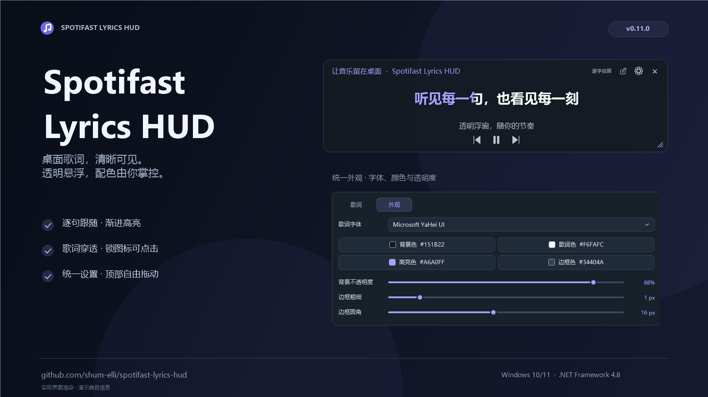

# Spotifast Lyrics HUD

[简体中文](README.md) | **English**



Actual UI controls rendered with demonstration track information.

An always-on-top lyrics overlay for [Spotifast](https://github.com/crmne/spotifast), built with C# and WPF. Includes gradual highlighting, Simplified Chinese conversion, and adjustable fonts, colours, transparency, borders, and window size.

## Download and run

Download **`Spotifast-Lyrics-HUD-v<version>-windows.exe`** from the [latest release](https://github.com/shum-elli/spotifast-lyrics-hud/releases/latest), place it in a writable folder, and run it. No installation or extraction is needed. A ZIP is also available.

Requirements:

- Windows 10 or 11.
- **Microsoft .NET Framework 4.8 or 4.8.1**. Windows 10 1903+ includes 4.8; Windows 11 includes 4.8 or 4.8.1. [Download the runtime](https://dotnet.microsoft.com/download/dotnet-framework/net48).
- Spotifast running under the same Windows account. Tested with version 0.17.1 at `%LOCALAPPDATA%\Programs\Spotifast\spotifast.exe`.

Settings are saved in `settings.json` beside the EXE. Keep this file when upgrading. License texts are embedded: right-click the tray icon and select **开源许可** (Open-source licenses) to read or copy them. No separate instruction or license files are required beside the EXE.

## Controls

Drag the title, status text, or empty space across the top bar to move the overlay. Drag the bottom-right handle to resize it. Open the gear button to change appearance and lyrics settings; sliders, dropdowns, and checkboxes follow the accent colour.

The overlay provides previous, play/pause, and next controls with transparent backgrounds. Locking prevents movement and resizing, hides every control except the unlock button, and lets mouse input pass through the lyrics. The unlock button accepts clicks without activating the overlay. Lock state is saved.

Use **Ctrl+Alt+L** or the tray menu to toggle locking. Settings show a warning if another application has reserved the shortcut.

The app stays in the system tray. Double-click the icon to show the overlay; right-click for visibility, locking, playback, settings, licenses, and exit. The overlay's × button hides it to the tray. Launching the EXE again also brings it back.

## Lyrics

Reads Spotifast's local lyric cache, matching tracks through play history and the current cached playlist. First plays do not need to wait for Spotifast's roughly 30-second history threshold. Tries LRCLIB when synced lyrics are missing. Online lookups send the track title, artist, album, and duration. Cache compatibility depends on the Spotifast version. After a miss or while an online lookup is pending, the local cache is checked every three seconds so newly available synced lyrics load automatically.

Estimated word highlighting uses line timestamps and may differ during sustained notes or pauses. Import Enhanced LRC for actual word timestamps. For plain lyrics, use the arrows or mouse wheel to change lines.

## Build

Build on Windows with its included C# compiler:

```powershell
powershell -NoProfile -ExecutionPolicy Bypass -File .\build.ps1 -Test
```

Generate the standalone EXE, optional ZIP, and SHA-256 checksums:

```powershell
powershell -NoProfile -ExecutionPolicy Bypass -File .\package.ps1
```

[GitHub Actions](https://github.com/shum-elli/spotifast-lyrics-hud/actions) builds and tests pushes and pull requests. A new `VERSION` on `main` automatically publishes a release; existing releases are preserved.

Ten historical source snapshots are available in the [versions/v0.1.0 through versions/v0.9.0 branches](https://github.com/shum-elli/spotifast-lyrics-hud/branches/all). They were recovered from development records; timestamps and hashes are in `versions.json`.

## Feedback

Everyone is welcome to [open an Issue](https://github.com/shum-elli/spotifast-lyrics-hud/issues) with bugs, feature requests, or suggestions. For bugs, please include your HUD and Spotifast versions, reproduction steps, and screenshots when possible. For lyric issues, also include the track title and artist.

## License

The HUD is licensed under [MIT](LICENSE). The embedded OpenCC 1.2.0 dictionaries are licensed under [Apache-2.0](data/opencc/LICENSE.txt), from this [pinned OpenCC revision](https://github.com/BYVoid/OpenCC/tree/907bfcbbd3aae86ff04bc8eaca67c8af03108ddf). Both license texts are available in the app's tray menu.
