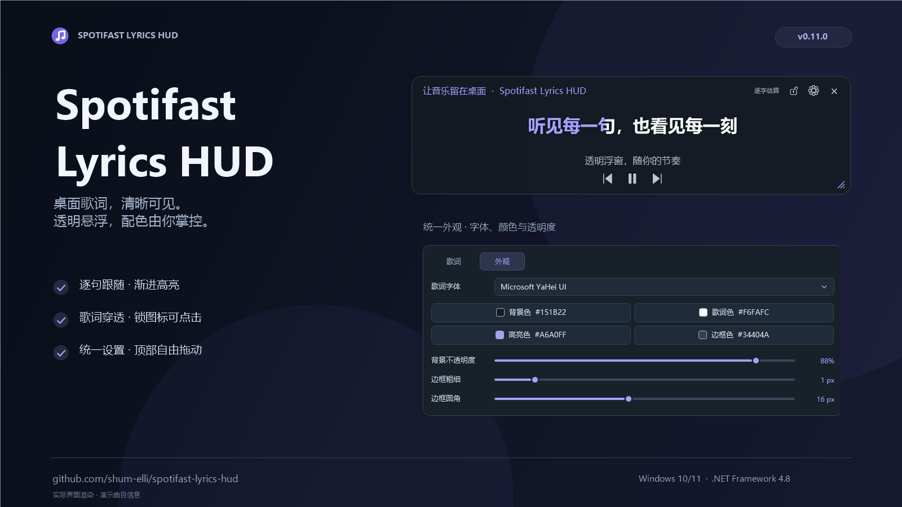

# Spotifast Lyrics HUD

**简体中文** | [English](README.en.md)

真实控件渲染，使用演示曲目信息。

为 Spotifast 提供独立置顶歌词、渐进高亮、简体转换及字体、颜色和窗口设置。C# / WPF。

浮窗底部支持上一曲、播放／暂停、下一曲。操作按钮使用透明背景，悬停时通过图标亮度反馈。右上角锁按钮可锁定移动和缩放，锁定状态自动保存。锁定后只保留解锁按钮，设置、关闭、播放控制及翻句按钮全部隐藏。

锁定后，歌词区域穿透鼠标，只有右上角锁图标可以点击解锁。锁按钮使用独立的小区域接收点击，并禁止激活窗口，避免切走游戏焦点。也可按 **Ctrl+Alt+L** 或通过托盘菜单切换锁定；若快捷键已被其他程序占用，设置页会提示。

程序常驻系统托盘。双击托盘图标显示浮窗，右键可显示／隐藏、锁定、控制播放、进入设置或退出。点浮窗的 × 隐藏到托盘，再次打开 exe 也可唤回窗口。

## 下载与运行

从 [Releases](https://github.com/shum-elli/spotifast-lyrics-hud/releases/latest) 下载 **`Spotifast-Lyrics-HUD-v版本号-windows.exe`**，放到可写目录后直接运行，无需安装或解压。ZIP 仅作为可选下载。

- Windows 10 / 11。
- **Microsoft .NET Framework 4.8 或 4.8.1**。Windows 10 1903 及以后包含 4.8，Windows 11 包含 4.8 或 4.8.1。[微软运行库下载](https://dotnet.microsoft.com/download/dotnet-framework/net48)
- 同一 Windows 账号下运行 Spotifast。已验证 0.17.1，安装位置为 %LOCALAPPDATA%\Programs\Spotifast\spotifast.exe。

解锁后点齿轮调整设置，拖动右下角改变窗口大小。配置保存在 exe 旁的 settings.json，升级时保留该文件。许可文本已内置，右键托盘图标 → **开源许可** 即可查看和复制，无需在程序目录放置额外说明或许可文件。

顶部的标题、状态文字及空白区域都支持拖动，操作按钮保留各自的点击功能。设置面板的滑杆、下拉框和复选框统一跟随当前强调色。

## 歌词

读取 Spotifast 本地缓存，结合播放历史和当前歌单缓存匹配歌曲；首次播放无需等待约 30 秒后才写入的历史记录。缺少同步版时尝试 LRCLIB。联网查询发送曲名、歌手、专辑和时长。缓存结构依赖 Spotifast 版本。首次未找到歌词或联网查询仍在进行时，每 3 秒检查一次本地缓存；后来出现的同步歌词会自动载入。

逐字估算基于行时间轴，拖音与停顿可能有偏差。支持导入带字词时间戳的增强 LRC。纯文本可以用箭头或滚轮翻句。

## 构建

Windows 自带 C# 编译器即可构建。

    powershell -NoProfile -ExecutionPolicy Bypass -File .\build.ps1 -Test

生成可直接运行的 EXE、可选 ZIP 和 SHA-256 校验文件

    powershell -NoProfile -ExecutionPolicy Bypass -File .\package.ps1

[GitHub Actions](https://github.com/shum-elli/spotifast-lyrics-hud/actions) 在推送与 PR 时构建和测试。main 上的新 VERSION 会自动发布对应 Release，已存在的版本会保留。

10 个历史源码快照位于 [versions/v0.1.0 至 versions/v0.9.0 分支](https://github.com/shum-elli/spotifast-lyrics-hud/branches/all)。它们从实际开发记录恢复，源码时间与哈希见 versions.json。

## 反馈

欢迎大家[提交 Issue](https://github.com/shum-elli/spotifast-lyrics-hud/issues)，反馈 Bug、提出功能需求或分享使用建议。遇到问题时，请尽量附上 HUD 与 Spotifast 的版本、复现步骤及截图；歌词问题也请注明歌曲和歌手。

## 许可

代码采用 [MIT](LICENSE)。OpenCC 1.2.0 词库采用 [Apache-2.0](data/opencc/LICENSE.txt)，来自 [OpenCC 固定提交](https://github.com/BYVoid/OpenCC/tree/907bfcbbd3aae86ff04bc8eaca67c8af03108ddf)，词库随程序嵌入。项目配合 [Spotifast](https://github.com/crmne/spotifast) 使用。
